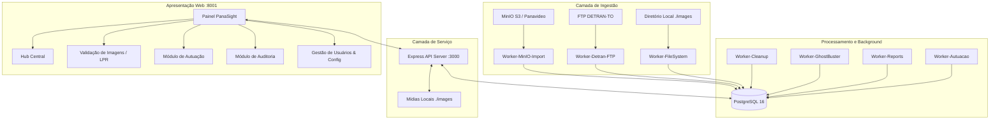

# System Blueprint — PanaSight (Painel de Validação e Autuação)

## 1. Visão Geral do Sistema
O **PanaSight 8001** (Painel de Validação) é uma solução de alta performance desenvolvida para triagem, validação, auditoria e autuação de infrações de trânsito baseadas em telemetria, câmeras OCR/LPR e evidências em foto/vídeo.
Integra-se com bases veiculares (DETRAN-TO, bases estaduais), armazenamento de mídia distribuído (MinIO S3 / FTP / FileSystem local) e banco de dados relacional PostgreSQL.

---

## 2. Pilha Tecnológica & Arquitetura
- **Runtime:** Node.js (CommonJS, Express v4)
- **Banco de Dados:** PostgreSQL 16 (Pool `pg`, fuso horário `America/Sao_Paulo`)
- **Processamento de Mídia:** `sharp` (imagens e redação) e `fluent-ffmpeg` (vídeos de infrações)
- **Gestão de Processos:** PM2 (`ecosystem.config.js`) orquestrando API e 7 workers independentes
- **Armazenamento / Ingestão:** AWS S3 SDK / MinIO S3 (`minio.panavideo.com.br`), FTP (`basic-ftp`), Sistema de Arquivos (`./images`)
- **Frontend:** Vanilla HTML5, CSS3 moderno, Vanilla JavaScript modular (SPA/Multi-página sem frameworks externos)
- **Ambiente & Container:** Docker & Docker Compose (`postgres:16-alpine`, `panasight_backend` na porta 8001:3000)

---

## 3. SLA & Requisitos Não-Funcionais
- **Disponibilidade:** Workers isolados via PM2 com reinicialização automática (`autorestart: true`).
- **Isolamento de Concorrência:** Travamento pessimista de evidências (`locked_by_user_id`, `locked_at`) para impedir validação simultânea de uma mesma infração.
- **Sessão Única:** Controle de token de sessão único por usuário para evitar logins concorrentes na mesma credencial.
- **Integridade Legal e Cadastral:** Consulta e enriquecimento com tabelas `detran_frota` e `detran_modelos`. Redação de imagem (`redacted_filename`) para privacidade e conformidade.
- **Auditoria Blindada:** Log detalhado de ações de autuação, rejeição e auditoria.

---

## 4. Módulos & Estrutura de Arquivos
- `backend/server.js`: API HTTP RESTful com rotas de autenticação, evidências, auditoria e relatórios.
- `backend/database.js`: Pooling PostgreSQL e migrações DDL automáticas.
- `backend/*-worker.js`: Processos desacoplados para importação, limpeza e geração de relatórios.
- `frontend/`: Interfaces web especializadas (`hub.html`, `index.html`, `autuacao.html`, `auditoria.html`, `admin.html`).
- `docker-compose.yml`: Orquestração de containers com mapeamento de fuso horário `America/Sao_Paulo`.
